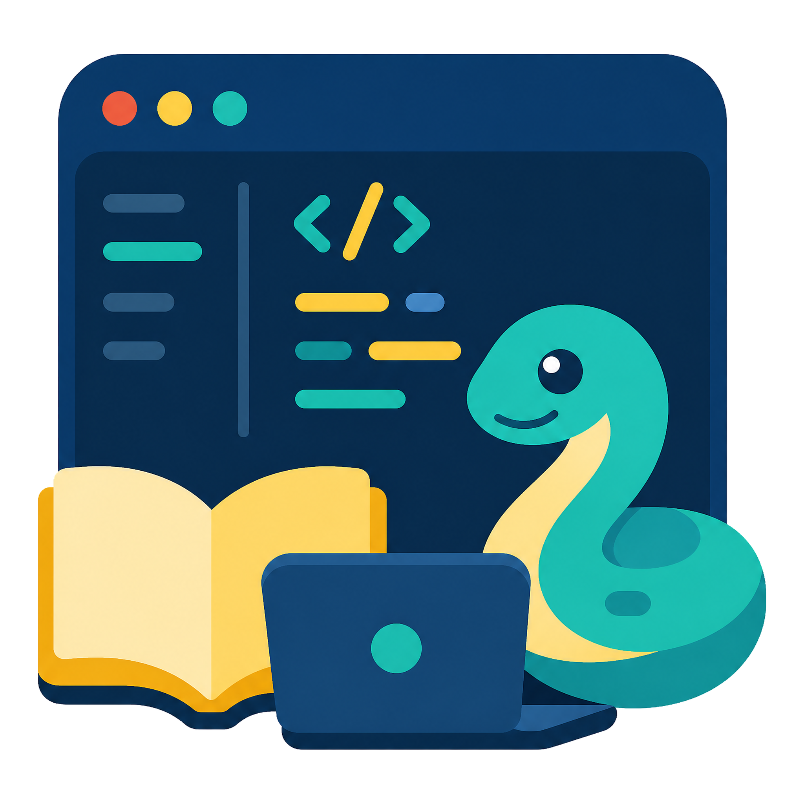
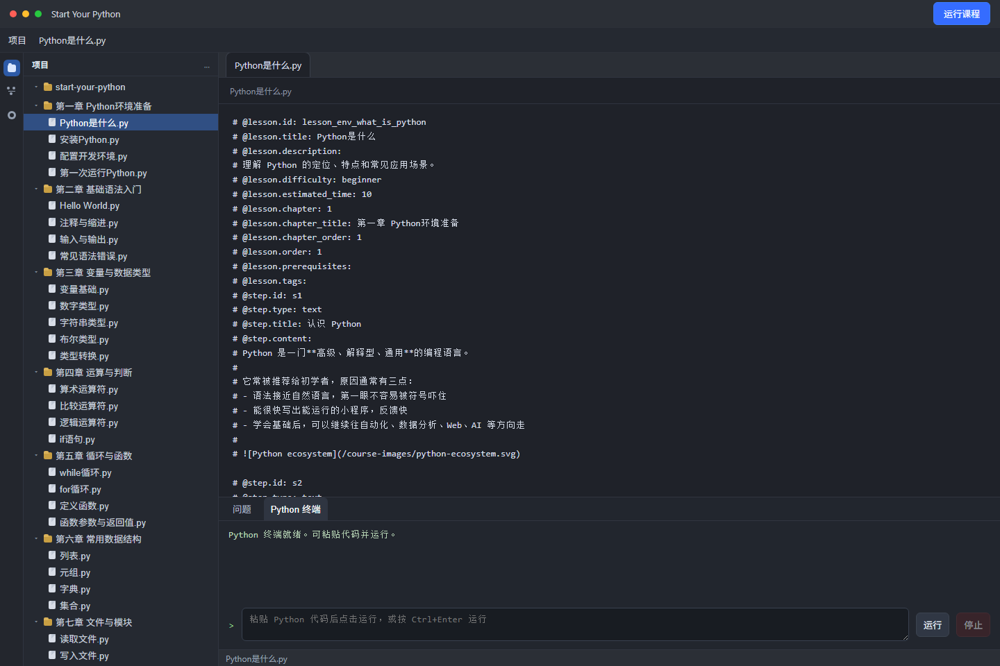

<div align="center">
  
  <h1>Start Your Python</h1>
  <p>面向 Python 初学者的本地学习工作区，把中文课程、示例代码和真实终端运行放在一个 PyCharm 风格界面里</p>
</div>

<p align="center">
  
  
  
  
  
</p>

<p align="center">
  <a href="https://github.com/sunnyhmz7010/start-your-python/releases"></a>
  <a href="https://github.com/sunnyhmz7010/start-your-python/blob/main/LICENSE"></a>
  <a href="https://github.com/sunnyhmz7010/start-your-python/actions/workflows/ci.yml"></a>
</p>

---

## ✨ 为什么做这个应用

初学 Python 时，常常需要在教程、编辑器和终端之间反复切换。Start Your Python 把中文讲解、示例代码、随堂测验和运行结果放在同一个工作区里，方便边学边练。

- 入门练习：按章节阅读课程，用本机 Python 运行示例并观察结果。
- 随时复习：在 Android 端阅读同一套课程，保存本机学习进度。

## 📸 截图预览

<p align="center">
  
</p>

## 🚀 核心能力

- 中文课程：内置 8 章、33 节课程，覆盖环境准备、基础语法、数据类型、判断、循环、函数、数据结构、文件、模块和面向对象入门。
- 桌面工作区：采用 PyCharm 风格布局，通过课程树、源码编辑区、学习步骤和底部终端组织学习过程。
- 本机运行：调用系统 Python 执行课程示例，展示标准输出、错误输出，支持 `input()` 交互和手动停止。
- 学习进度：记录最近学习的课程、当前步骤和完成状态，支持随堂测验、手动标记和进度重置。
- 移动阅读：提供 Android 专用阅读布局，可查看讲解、示例和测验，无需安装 Python。
- 本地课程：通过带注解的 `.py` 文件维护课程，支持 Markdown 讲解、图片和独立的运行代码。

## ⚡ 快速开始

### 📋 前置要求

- Windows：使用 x64 或 ARM64 设备，系统需具备 [Microsoft Edge WebView2 Runtime](https://developer.microsoft.com/microsoft-edge/webview2/)。
- Python：桌面端运行示例需自行安装 Python 3，确保终端能执行 `python --version` 或 `py -3 --version`；应用不内置解释器。
- Android：使用 ARM64 或 x86_64 设备，课程阅读不依赖系统 Python。

### 📦 安装与运行

#### 🖥️ Windows 便携版

1. 从 [最新 Release](https://github.com/sunnyhmz7010/start-your-python/releases/latest) 下载以 `win-amd64.zip`（x64）或 `win-arm64.zip`（ARM64）结尾的便携包。
2. 完整解压，保留同级的 `lessons/` 目录，运行 `Start Your Python.exe`。
3. 在左侧选择第二章的 `Hello World.py`，点击“运行课程”，再点击“运行代码”，底部“Python 终端”会输出 `Hello, World!`。

#### 📱 Android 阅读版

1. 从 [最新 Release](https://github.com/sunnyhmz7010/start-your-python/releases/latest) 下载以 `android-arm64-v8a-release.apk` 或 `android-x86_64-release.apk` 结尾的文件，选择与设备架构匹配的版本。
2. 打开 APK，按系统提示允许当前来源安装应用并完成安装。
3. 打开应用，点击“选择课程”，选择章节后即可阅读讲解、查看示例和回答测验。

## 📖 使用说明

### 🧑‍🎓 阅读课程

桌面端从左侧课程树选择 `.py` 文件，先查看源码，再点击顶部“运行课程”进入步骤学习。右侧可切换步骤、查看完成状态；Android 端通过“选择课程”打开目录，使用“上一步”“下一步”阅读。

### ▶️ 运行示例

桌面端在代码步骤点击“运行代码”，结果显示在底部“Python 终端”。程序等待 `input()` 时，在输入框填写内容后按 Enter 或点击“发送”；需要中断时点击“停止”。

终端空闲时，也可直接粘贴 Python 代码，点击“运行”或按 Ctrl+Enter 执行。未检测到解释器时，点击“去学习安装 Python”，安装后重启应用，或在终端点击“重新检测 Python”。

### ✅ 完成进度

课程步骤可以通过三种方式完成：

- 手动完成：桌面端点击“下一步”“标记完成”或“标记本步完成”；Android 端点击“下一步”“完成本课”或“标记已读”。
- 代码练习：课程步骤运行后以退出码 0 结束，自动标记该步骤完成；直接在终端运行代码不计入课程进度。
- 随堂测验：选择正确答案后自动标记该步骤完成。

可通过“取消本步完成”或“取消已读”撤销标记，通过“重置本课”重新学习当前课程。

## 🧠 功能细节

### 🗂️ 本地课程模型

- 课程来源：桌面端优先读取本地 `lessons/`；目录加载或解析失败时回退到内置课程，并在“问题”面板显示提示。Android 和浏览器使用构建时打包的课程。
- 目录排序：章节和课程按文件中的 `chapter_order`、`order` 元信息排序。
- 课程更新：修改桌面端外部 `lessons/` 后重启应用；更新 Android 或 Web 内置课程需重新构建。
- 图片引用：将图片放在 `public/course-images/`，在课程 Markdown 中使用 ``；新增图片需重新构建应用。

### ✍️ 课程注解格式

课程文件通过 `# @lesson.*` 声明元信息，通过 `# @step.*` 声明讲解、代码和测验。以下示例包含完整的课程必填字段：

```python
# @lesson.id: lesson_syntax_hello_world
# @lesson.title: Hello World
# @lesson.description: 学习 print 输出。
# @lesson.difficulty: beginner
# @lesson.estimated_time: 5
# @lesson.chapter: 2
# @lesson.chapter_title: 第二章 基础语法入门
# @lesson.chapter_order: 2
# @lesson.order: 1

# @step.id: s1
# @step.type: code
# @step.title: print 函数
# @step.content: print 会把括号里的内容显示到终端。
print("Hello, Python!")

# @step.id: q1
# @step.type: quiz
# @step.title: 小测验
# @step.content: 哪个函数可以输出内容？
# @step.option: a | print()
# @step.option: b | input()
# @step.correct_answer: a
```

默认执行代码步骤展示的内容；声明 `# @step.runtime:` 时，使用该字段提供的完整代码执行，可补充不向学习者展示的运行上下文。

### 🧪 运行与保存边界

- 执行环境：仅 Tauri 桌面端可调用本机 Python；Android 阅读端和普通浏览器不提供 Python 执行能力。
- 执行时限：单次运行最多 30 秒，等待 `input()` 也计入时限；超时会自动终止。
- 执行权限：Python 进程使用当前用户权限，请只运行可信代码。
- 源码修改：编辑区中的修改仅保留在当前会话，不会写回课程文件；学习态执行原课程步骤，需要长期调整时直接修改 `lessons/` 文件。
- 进度保存：学习状态保存在本机 `localStorage`，无需账号，桌面端和 Android 端各自记录，不进行云端同步。

## 🧱 技术栈

- Vue 3、TypeScript：实现桌面学习工作区与移动阅读界面。
- Pinia、Vue Router：管理课程、学习进度、运行状态和页面路由。
- Tauri 2、Rust：提供桌面窗口、本地课程读取和 Python 进程管理。
- Python 3：作为用户自行安装的课程示例运行时。
- Capacitor 7：将阅读界面打包为 Android 应用。
- Marked：将课程中的 Markdown 讲解转换为 HTML。
- Vite：提供前端开发服务和静态资源构建。
- Vitest、Vue Test Utils、vue-tsc：提供单元测试、组件测试与类型检查。

## 🗂️ 项目结构

```text
start-your-python/
├─ src/                         # Vue 应用源码
│  ├─ components/                # 工作区、课程内容等 UI 组件
│  │  ├─ content/                # Markdown 和课程内容渲染
│  │  └─ workspace/              # PyCharm 风格学习工作区
│  ├─ services/                  # 课程加载、内容解析、Python 运行时检测与执行
│  ├─ stores/                    # 学习进度、终端状态等 Pinia store
│  ├─ router/                    # 页面路由
│  ├─ views/                     # 桌面端和移动端页面视图
│  └─ utils/                     # HTML 清理等通用工具
├─ src-tauri/                    # Tauri 桌面壳、Rust 命令和应用配置
├─ lessons/                      # 中文 Python 课程源码与步骤内容
├─ public/                       # Web 静态资源、favicon 和课程图片
├─ resources/                    # Tauri/Capacitor 图标生成源资源
├─ scripts/                      # 发布和打包脚本
├─ tests/                        # Vitest 测试
├─ capacitor.config.ts           # Capacitor 移动端配置
├─ vite.config.ts                # Vite 构建配置
└─ package.json                  # npm 脚本、依赖和版本信息
```

## 👨‍💻 本地开发

### 🧰 环境

- Node.js：22，与仓库构建环境使用的版本一致。
- 桌面平台：Windows，现有桌面 npm 脚本使用 PowerShell。
- Rust：stable 工具链，Windows 使用 MSVC 目标。
- Windows 构建组件：Microsoft C++ Build Tools 的“使用 C++ 的桌面开发”工作负载，以及 WebView2，参见 [Tauri 环境要求](https://v2.tauri.app/start/prerequisites/#windows)。
- Android 构建环境：JDK 21、Android SDK 35，配置 `JAVA_HOME` 和 `ANDROID_HOME`，版本要求参见 [Capacitor 7 文档](https://capacitorjs.com/docs/updating/7-0#android)。

### 📦 准备源码

```bash
git clone https://github.com/sunnyhmz7010/start-your-python.git
cd start-your-python
npm ci
```

### 🌐 Web 开发

```bash
npm run dev -- --host 127.0.0.1
```

构建静态文件至 `build/`：

```bash
npm run build
```

### 🖥️ 桌面开发

```powershell
npm run tauri:dev
```

构建桌面可执行文件至 `src-tauri/target/release/`：

```powershell
npm run tauri:build
```

### 📱 Android 构建

```powershell
npm run build:mobile
npx cap add android
npm run android:sync
cd android
.\gradlew.bat assembleDebug
```

`npx cap add android` 仅首次执行；调试 APK 位于 `android/app/build/outputs/apk/debug/`。以下质量检查在项目根目录执行。

### ✅ 质量检查

```bash
npm run typecheck
npm run test
```

## 🔐 安全报告

如果发现安全问题，请不要公开披露细节。请优先参考仓库中的 [SECURITY.md](./SECURITY.md) 提交安全报告。

## 📄 许可证

本项目基于 [GPL-3.0](./LICENSE) 开源。

<div align="center">
  <sub>Built with ❤️ by Sunny</sub>
</div>
